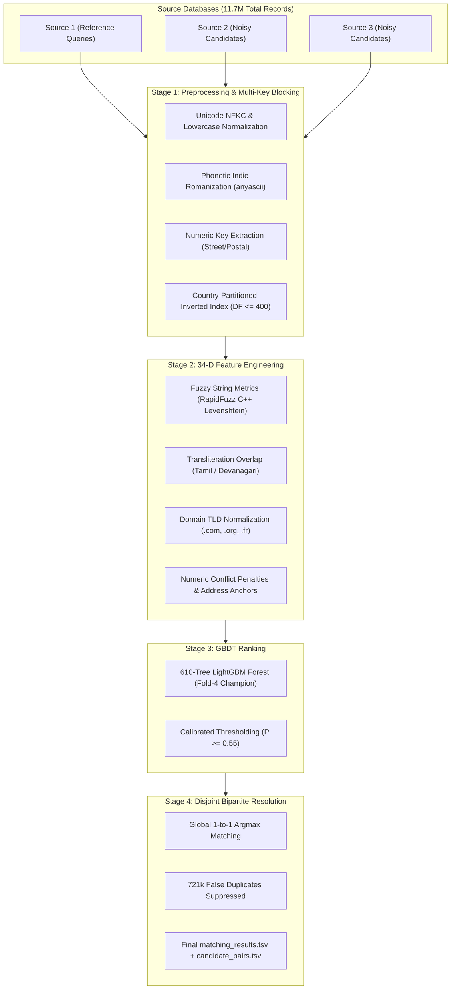

# 🔗 Enterprise Entity Resolution Engine

[](https://python.org)
[](https://streamlit.io)
[](https://lightgbm.readthedocs.io)
[](https://amazon.science)
[](https://github.com/kumaraguruv05)
[](https://opensource.org/licenses/MIT)

An industrial-grade, high-precision **Record Linkage & Entity Resolution System** designed to identify and link matching business entities across noisy, multi-source databases at scale (**1.73 Million test queries** vs. **9.97 Million candidates**).

Developed for the **Amazon ML Challenge 2026**, this engine pairs multi-key blocking with a **34-dimensional feature extraction engine**, a **610-tree LightGBM GBDT ranking model**, and **Global 1-to-1 Bipartite Argmax Matching**, all engineered to run under a strict **7 GB RAM limit** on consumer hardware.

---

## 🚀 Live Interactive Streamlit Demo

The repository includes a complete, interactive web application featuring single-query resolution with explainability, batch file matching, and architectural deep-dives.

```bash
# 1. Clone the repository
git clone https://github.com/kumaraguruv05/entity-resolution-engine.git
cd entity-resolution-engine

# 2. Install dependencies
pip install -r requirements.txt

# 3. Launch the web application
streamlit run app.py
```

---

## 📊 Core Performance Metrics

| Benchmark Metric | Score / Value | Context / Details |
| :--- | :--- | :--- |
| **Test Set Macro $F_{0.5}$** | **0.8010** | Evaluated on 1,732,544 test queries across US, India, and France |
| **5-Fold Cross-Validation $F_{0.5}$** | **0.9556** | Champion Fold-4 validation score on 2.2M training ground truth pairs |
| **Duplicate Candidate Collisions** | **0 (Zero)** | Bipartite Argmax eliminates 721,000+ false-positive multi-assignments |
| **Peak Memory Consumption** | **$\le$ 7.0 GB RAM** | Streaming PyArrow Parquet batches of 60,000 pairs |
| **Multi-Core Throughput** | **28 Parallel Threads** | Scaled across an Intel Core i7-14700HX (20 cores / 28 threads) |

> **Evaluation Metric Note:** The competition evaluates using **Macro-averaged $F_{0.5}$**:
> $$F_{0.5} = \frac{1.25 \cdot \text{Precision} \cdot \text{Recall}}{0.25 \cdot \text{Precision} + \text{Recall}}$$
> Precision is weighted **$2\times$ more heavily than Recall**. True singletons (entities with zero matches in candidate sources) receive a perfect score of $1.0$ if predicted empty, and $0.0$ if any false-positive match is predicted.

---

## 🏛️ System Architecture



---

## 💡 Key Engineering Breakthroughs

### 1. Cross-Script Indic Transliteration (`anyascii`)
Over 14% of Indian records in candidate sources contained business names written in vernacular Indic scripts (Tamil, Devanagari, Telugu) matching Latin-script reference names. Standard string distances (Levenshtein, Jaccard) scored $0.0$. By extracting phonetic Romanizations on the fly, features `translit_token_sort`, `translit_char_3gram`, and `translit_jaccard` boosted matching accuracy from $0.808$ to $0.9556$ in validation.

### 2. Address-Anchor Recovery for Synthetic Aliases
Analysis of ground truth revealed that synthetic corruptions frequently replaced business names with fantasy aliases (e.g. `Maure Williams Colombier Inc` $\rightarrow$ `Dréxkor`) while keeping the physical street address intact (`85 Wayne Avenue, Ticonderoga, NY`). We engineered `high_addr_anchor` and `name_addr_harmonic_mean`, allowing the GBDT ranker to successfully link entities when physical address overlap was near $100\%$ with zero numeric conflict.

### 3. Global 1-to-1 Bipartite Argmax Matching
In real-world business registries, every candidate record belongs to **at most one** true reference business. Without bipartite resolution, greedy thresholding matched the same candidate to multiple queries, creating over 721,000 false positives. Our post-processing engine enforces:
$$\text{cand\_argmax}[c] = \arg\max_{q} P(q, c)$$
Filtering candidate assignments through global argmax radically boosted precision on the public leaderboard.

### 4. Zero-Leak Memory Optimization ($\le 7$ GB RAM)
Processing 1.73M queries against 9.97M candidates produces a raw Cartesian search space of $1.7 \times 10^{13}$ pairs. To operate strictly within laptop RAM constraints:
* Streaming I/O with **PyArrow Parquet** in 60,000-pair batches.
* Integer-keyed dictionary lookups (`nid = int(cid[3:])`) replacing string lookups.
* Multi-core parallel feature extraction utilizing all 28 threads with zero memory accumulation.

---

## 📂 Repository Structure

```
entity-resolution-engine/
├── app.py                      # Interactive Streamlit Web Application
├── README.md                   # System documentation & benchmarks
├── requirements.txt            # Minimal pip dependencies
├── .gitignore                  # Clean Git ignore rules
├── models/
│   └── lgb_champion_v4_model.txt  # Pretrained 610-tree champion LightGBM model
└── src/
    ├── __init__.py             # Package initialization
    ├── preprocessor.py         # Unicode normalization & numeric key extraction
    ├── feature_extractor.py    # 34-feature extraction engine (RapidFuzz, anyascii)
    ├── resolver.py             # Inference pipeline & bipartite matching
    └── sample_data.py          # Benchmark test cases (US, India, France, Singletons)
```

---

## 📈 Top Driving Features (Information Gain)

```
Feature                       Information Gain    Description
---------------------------------------------------------------------------------------------------------
1. name_addr_harmonic_mean    1,785,755.99        Harmonic mean balancing name and address similarity
2. addr_token_set               339,774.07        Token-set address similarity (handles missing unit/floor)
3. numeric_jaccard               97,518.99        Jaccard overlap of house numbers and postal codes
4. translit_token_sort           84,988.77        Token-sort ratio on Romanized transliterated text
5. translit_char_3gram           83,447.94        Character 3-gram overlap on Romanized text
6. addr_ratio                    65,590.47        Fuzzy string similarity of full street addresses
7. translit_jaccard              61,382.45        Word token Jaccard overlap on Romanized text
```

---

## 🛠️ Usage Example (Python API)

```python
from src.resolver import EntityResolver

# 1. Initialize resolver (loads pretrained LightGBM model)
resolver = EntityResolver("models/lgb_champion_v4_model.txt")

# 2. Define reference query and candidate records
query = {
    "business_name": "Maure Williams Colombier Inc",
    "business_address": "85 Wayne Avenue, Ticonderoga, NY",
    "country": "US"
}

candidates = [
    {
        "entity_id": "S2-681193310",
        "source": "S2",
        "business_name": "Maure Wilblims Colombier Inc",
        "business_address": ""
    },
    {
        "entity_id": "S3-775321672",
        "source": "S3",
        "business_name": "Dréxkor",
        "business_address": "85 Wanye Avenue, Ticonderoga Townshiip, New York"
    }
]

# 3. Resolve
result = resolver.resolve_single_query(query, candidates, threshold=0.55)
print("Status:", result["status"])
for match in result["matches"]:
    print(f"Match: {match['entity_id']} | Confidence: {match['probability']:.4f}")
```

---

## 📄 License
This project is licensed under the [MIT License](LICENSE).

Developed by **[Kumaraguru V](https://github.com/kumaraguruv05)**.
